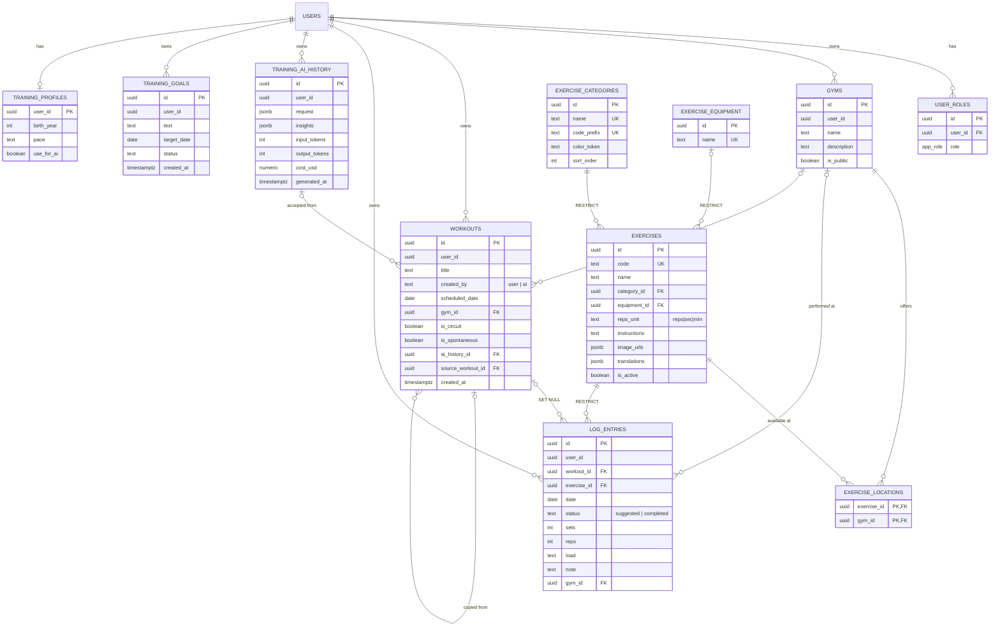

#  RappGym

A mobile-first training log for a home gym (Gymstick HomeGym 3.0 and other locations). Browse illustrated exercise instructions, plan workouts (yourself or with AI), run them as circuits, log every set and follow your progress over time.

Live: https://gym.rappen.net

## Features

- **Exercise bank:** stored in the database and edited in the app (codes such as `LE6`, `PU1`), with categories, illustrations, Swedish/English text and per-location availability.
- **Train:** planned workouts (own or AI) with a guided circuit runner. Each lap logs one completed set per exercise, and you can adjust loads between laps.
- **Log:** completed facts only, grouped per workout with ISO dates and weekday. "Plan again" copies a workout with a new name, date, location and circuit setting.
- **Statistics:** weight and set trends per exercise, filtered by location and period. Planned work is never counted.
- **AI:** analysis and structured workout planning through Lovable AI Gateway, on explicit request only. It shows an estimated and actual cost per request and keeps a persistent history.
- **Home:** dashboard with key figures, the ongoing or today's workout, and soft goals.
- **Access:** sign in with Google or Microsoft only. A global admin manages exercises, locations and users. Everyone else is a normal user who sees only their own data.

## Principles

- Suggestions (`status = 'suggested'`) and completed facts (`status = 'completed'`) are kept strictly apart. Completed history is never rewritten retroactively.
- Every delete requires confirmation.
- Dates are always ISO 8601 (`YYYY-MM-DD`).
- The relational model is normalized and uses real foreign keys. Row-level security scopes personal data to its owner.

## Tech stack

- TanStack Start (React 19, Vite 7) running on an edge runtime
- Tailwind CSS v4 with semantic design tokens in `src/styles.css`
- PostgreSQL with row-level security, auth and storage on Lovable Cloud
- React Query for client-side data reads
- Lovable AI Gateway for training insights and exercise pictures
- Vitest for tests of the pure domain modules in `src/lib`

## Getting started

```sh
bun install
bun run dev        # http://localhost:8080
bunx vitest run    # run the test suite
```

| Path | Contents |
| --- | --- |
| `src/routes/` | Pages. English URLs; legacy Swedish URLs redirect. |
| `src/components/gym/` | Feature components (runner, builder, log sheet, AI) |
| `src/lib/` | Pure domain logic, queries and server functions (`*.functions.ts`) |
| `drizzle/migrations/` | SQL migrations, the source of truth for the schema |
| `supabase/schema.puml` | PlantUML data model, kept in sync with the migrations |

## Usage

1. Sign in, then pick your location from the avatar menu.
2. **Train:** start a new workout or open a planned one, then press *Start workout*. Toggle *Run as circuit* to go lap by lap.
3. **Log:** review completed workouts, press the repeat icon to plan one again, or the trash icon to delete it (with confirmation).
4. **AI:** choose the number of workouts, days, purpose, length, location and start date, then accept the suggestions you want. They appear under Train.
5. **Settings** (admin only, via the avatar): locations, exercises and users.

## Data model

The full PlantUML model lives in [`supabase/schema.puml`](supabase/schema.puml). Below is the same model as a Mermaid diagram, which GitHub renders.



